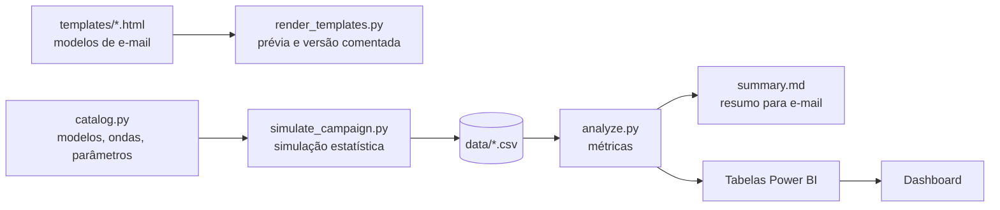
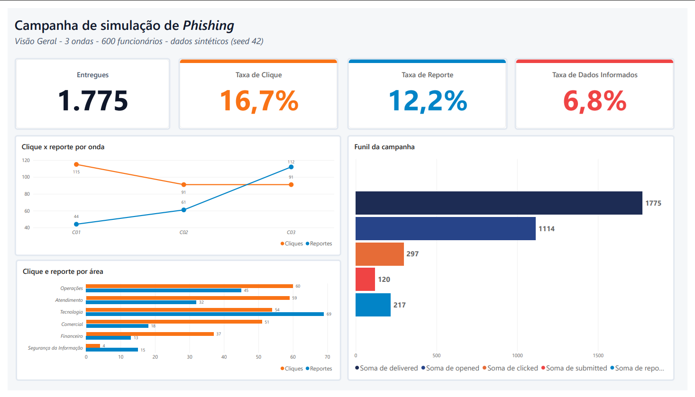

# Phishing Campaign Simulator

[](https://github.com/mateus-macciel/phishing-campaign-simulator/actions/workflows/ci.yml)


Kit de **conscientização em phishing**: modelos de e-mail para treinamento, uma **simulação estatística
de campanha** em Python (3 ondas) e as tabelas para um **dashboard de overview da campanha** em Power BI.

> **Uso responsável.** Este projeto **não envia e-mails**, não coleta dados e não rastreia ninguém. Os
> dados são sintéticos e os modelos usam uma empresa e domínios fictícios (`.test`, reservado pela
> RFC 2606), sem imitar marcas reais. Os testes garantem que os modelos não tenham formulários,
> scripts ou domínios reais. Em campanhas de verdade, exija autorização formal (Segurança, RH e
> Jurídico), comunicação prévia, respeito à LGPD e resultados por grupo, sem punição individual.

## O que o projeto faz



## Modelos de e-mail

Três modelos com gatilhos diferentes, em [`templates/`](templates/). Cada um tem uma versão comentada
com os sinais de alerta (gerada por `render_templates.py`) e uma página educativa exibida depois do
clique, que explica o que era a simulação sem coletar nenhum dado.

| Modelo | Gatilho | Dificuldade |
|---|---|---|
| T01 Reembolso de despesas | Recompensa | Média |
| T02 Senha de rede expirando | Urgência | Fácil |
| T03 Documento compartilhado | Colaboração | Difícil |

Análise de cada modelo e checklist para o usuário em [`docs/anatomia-do-phishing.md`](docs/anatomia-do-phishing.md).

## Simulação

600 pessoas fictícias (área, senioridade, tempo de casa, regime de trabalho) recebem 3 ondas, uma por
mês. A probabilidade de clique depende do modelo, da área, do tempo de casa, do regime de trabalho e
do dispositivo, e **melhora com o aprendizado**: quem clicou recebe microtreinamento e clica menos na
onda seguinte; quem reportou reporta mais. Os tempos de abertura, clique e reporte seguem
distribuições log-normais. Todos os parâmetros estão em `src/catalog.py` e no topo de
`src/simulate_campaign.py`.

## Métricas

Clique, dados informados (simulado), reporte, reportes por clique, tempo até clique e reporte,
reincidentes, comparação por área, modelo e dispositivo. Definições e cuidados de interpretação em
[`docs/metricas.md`](docs/metricas.md).

## Como rodar

Requisitos: Python 3.10+ (testado com Python 3.12 e pandas 3).

```bash
git clone https://github.com/mateus-macciel/phishing-campaign-simulator.git
cd phishing-campaign-simulator

python -m venv .venv
source .venv/bin/activate        # Windows: .venv\Scripts\activate
pip install -r requirements.txt

python src/simulate_campaign.py --employees 600 --seed 42   # 1) simula a campanha
python src/analyze.py                                       # 2) métricas, resumo e tabelas Power BI
python src/render_templates.py                              # 3) prévias dos e-mails
python -m unittest discover -s tests -v                     # testes
```

Com `make`: `make demo` e `make test`.

## Saídas

| Arquivo | Para quê |
|---|---|
| `output/summary.md` | Resumo da campanha, pronto para enviar por e-mail |
| `output/powerbi/*.csv` | Tabelas do dashboard (modelo em estrela) |
| `output/preview/*.html` | Prévia de cada e-mail, versão comentada e página educativa |

Exemplos gerados com a seed padrão estão em [`examples/`](examples/).

### Exemplo de resultado (seed 42)

Clique de 19,4% na 1ª onda para 15,4% na última, enquanto o reporte sobe de 7,4% para 19,0% e passa a
superar o clique. Áreas comerciais e de atendimento clicam mais; a equipe de segurança clica menos.

## Dashboard (Power BI)

Visão geral da campanha: funil (enviados, entregues, abertos, cliques, dados informados, reportes),
evolução por onda, comparação por área e modelo.





Modelo de dados exportado em `output/powerbi/`:

| Tabela | Conteúdo |
|---|---|
| `dim_employee` | Área, senioridade, regime de trabalho, tempo de casa |
| `dim_campaign` | Onda, data, modelo, gatilho, dificuldade, remetente |
| `dim_outcome` | Resultado final de cada pessoa (informou dados, clicou, reportou, abriu, ignorou) |
| `fact_event` | Uma linha por pessoa e onda: indicadores 0/1, minutos até cada evento, dispositivo |

## Decisões de design

- **Simulação, não envio:** o ciclo completo de análise e dashboard funciona sem tocar em ninguém.
- **Catálogo único** (`src/catalog.py`): modelos, ondas e parâmetros num só lugar.
- **Guardas de segurança nos testes:** sem formulários, scripts ou domínios fora de `.test`.
- **Métricas agregadas:** grupos pequenos não são ranqueados e não há listas de pessoas.
- **Resultados reprodutíveis:** mesma seed, mesmos dados, em qualquer máquina.

## Limitações e próximos passos

- O comportamento é um modelo estatístico simplificado, não dados reais.
- Próximos passos: integração com um provedor de simulação real (com autorização), reporte via botão
  no cliente de e-mail e uma regra de segmentação por risco para as próximas ondas.

## Estrutura

```
phishing-campaign-simulator/
├── src/
│   ├── catalog.py             # modelos, ondas e parâmetros
│   ├── simulate_campaign.py   # simulação estatística
│   ├── analyze.py             # métricas, resumo e exportação Power BI
│   └── render_templates.py    # prévias dos e-mails
├── templates/                 # modelos de e-mail e página educativa
├── data/                      # dados sintéticos (CSV)
├── tests/                     # simulação, análise e guardas de segurança
├── docs/                      # anatomia dos modelos e métricas
├── examples/                  # exemplos de saída
└── .github/workflows/         # CI
```

## Licença

MIT. Veja [`LICENSE`](LICENSE).

---

## English summary

A **phishing-awareness** toolkit: three training e-mail templates (fictitious company, reserved `.test`
domains), a **statistical simulation** of a three-wave campaign in Python, and Power BI-ready tables for a
campaign overview dashboard. **No e-mail is ever sent and no real person is involved**; tests enforce that
templates contain no forms, scripts or real domains.

```bash
pip install -r requirements.txt
python src/simulate_campaign.py --employees 600 --seed 42
python src/analyze.py
python src/render_templates.py
python -m unittest discover -s tests -v
```
